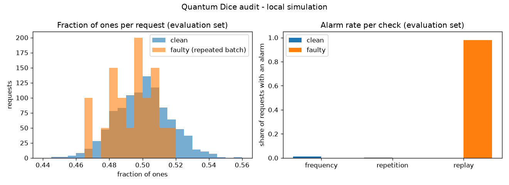

# Quantum Dice: Random or Rigged?  (direction: the repeated batch)

All results below are **local simulation**. The simulator samples with a pseudorandom generator: we model a quantum-bit source, we do not produce physical quantum entropy, and these bits must not be used for passwords or keys.

## How to run

```bash
python -m venv .venv && source .venv/bin/activate     # Python 3.10-3.13
pip install -r requirements.txt
python source.py      # layer 1: the quantum coin (self-check)
python service.py     # layer 2: clean and faulty service (self-check)
python auditor.py     # layer 3: the auditor (self-check)
python evaluate.py    # layer 4: tuning + fresh evaluation -> results/evaluation.csv, results/figure.png
```

Every script runs from a fresh process; all randomness comes from a documented seed schedule, so the numbers below reproduce exactly.

## Research question

We will investigate whether **re-seeding the simulator with the same seed on every request** can cause **identical "random" batches across requests**, and whether a **cross-request replay detector** can detect it.

| Item | Our answer |
|---|---|
| Protected property | Freshness: every request returns new, unpredictable bits |
| Fault (one bounded capability) | The service layer calls `sv.seed(1234)` on every request. This is a mock classical service bug, not a physical quantum effect |
| Trusted components | The one-qubit model (H on \|0>), Qiskit's `Statevector`, our auditor code |
| Auditor access | Bits only, in order, with request boundaries. No seeds, configuration or source code |
| Exclusions | Real hardware, physical entropy, device-independent certification, cryptographic security |

**Prediction (written before running):** this fault should break freshness across requests, while the fraction of ones might still look normal.

## Layer 1: clean quantum baseline (`source.py`)

One qubit starts in \|0>; a Hadamard gate prepares (\|0> + \|1>)/√2; measuring gives 0 or 1, each with probability \|1/√2\|² = 1/2 (Born rule). `Statevector.sample_memory(n)` repeats the prepare-and-measure n times and keeps the order. A finite batch is not exactly half ones: for 1,024 bits, 95% of batches land in 0.5 ± 0.031. Observed: 0.4995 ones over 100,000 draws.

## Layer 2: the fault (`service.py`)

Both services expose the same interface, `request(n) -> bits`, so the auditor can evaluate either.

- `CleanService` creates one random generator at start-up and keeps it: each request continues the stream (fresh bits).
- `RepeatedBatchService` re-seeds with the same fixed seed on every request, so every request replays exactly the same bits.

Observed: two clean requests differ (0.537 and 0.481 ones); two faulty requests are identical (0.502 ones each). The prediction held: the faulty output looks perfectly balanced.

## Layer 3: the auditor (`auditor.py`)

| Check | Question it answers | Assumption | Alarm rule | What it can miss |
|---|---|---|---|---|
| Frequency | Is this batch consistent with P(1) = 1/2? | Independent fair bits | Exact two-sided binomial test, p < 0.01 | Anything that keeps the balance: replays, predictable streams |
| Repetition count (NIST SP 800-90B style) | Is a value repeated 21 times in a row? | 1 bit of entropy per sample (cutoff 1 + ⌈20/H⌉ = 21, α = 2⁻²⁰) | Longest run ≥ 21 | Faults that keep runs normal, including replays |
| Replay | Did this request's first 64 bits appear in an earlier request? | Fresh bits repeat a 64-bit prefix with probability 2⁻⁶⁴ per pair | Any repeat | The first faulty request, offset or partial replays, unique-but-predictable streams |

Using the first 64 bits as the fingerprint (instead of the whole batch) also catches replays when the request size changes.

## Layer 4: evaluation on fresh data (`evaluate.py`)

- Seed schedule: **tuning set** = service seeds 0-19, used only to confirm each check's false-alarm rate; **evaluation set** = seeds 1000-1019, fresh data that was not looked at while choosing the thresholds. The thresholds (0.01, 21, any repeat) were fixed before the evaluation run and were not changed afterwards.
- Each seed is one service instance serving 50 requests of 1,024 bits: 1,000 batches (1,024,000 bits) per service per set.

Results, evaluation set (`results/evaluation.csv`):

| Check | Clean batches: false alarms | Faulty batches: detections | Faulty batches: misses |
|---|---|---|---|
| Frequency | 13 / 1000 (1.3%) | 0 / 1000 (0%) | 1000 |
| Repetition count | 1 / 1000 (0.1%) | 0 / 1000 (0%) | 1000 |
| **Replay** | **0 / 1000 (0%)** | **980 / 1000 (98%)** | **20** |

Tuning set, for comparison: frequency 8/1000 (0.8%), repetition 1/1000 (0.1%), replay 0/1000 false alarms; replay detected 980/1000 faulty batches. The clean false-alarm rates match the design (~1% and ~0.1%).

**Which faulty batches were missed and why:** all 20 replay misses are the first request of each faulty instance. A replay can only be recognized once something has been seen before; the first batch of a broken service is indistinguishable from a fresh one.



Left: the faulty batches sit inside the normal spread of clean batches, so a frequency check cannot separate them. Right: only the replay check reacts to the fault, with no false alarms on clean data.

## Extension: someone who knows the seed scheme

We also tested a service that uses a **new but guessable seed on every request** (base seed + request number). Our auditor raised **0 alarms on all three checks over 50 requests**, yet an attacker who knows the scheme reproduced **50 / 50 batches exactly**. Freshness checks on the bits cannot detect predictability: that needs access to how the service seeds its generator, or a certified entropy source.

## Recommended response

1. **Fix the root cause:** seed the generator once per service lifetime from OS entropy (no fixed seed), never per request, and add a regression test that two requests must differ.
2. **Monitor continuously:** run the replay check inside the service and fail closed (stop serving bits) on an alarm.
3. **Detection is not repair:** every batch served since the bug appeared is compromised. Notify consumers and regenerate anything derived from those bits.
4. **For real devices:** validate the entropy source and run NIST SP 800-90B health tests; output statistics alone cannot certify a generator.

## Limitations

- Simulation only: the bits come from a pseudorandom generator, not physical quantum measurements.
- One fault model, one batch size (1,024 bits), 20 instances × 50 requests per set. Other sizes, fault strengths or replay patterns may behave differently.
- The replay check needs requests of at least 64 bits, misses the first faulty request, and misses replays that start at an offset or reuse only part of a block.
- It cannot detect unique-but-predictable output (see the extension).
- Running three checks on many batches adds up false alarms: about 1.4% of clean batches raise at least one alarm here, so an alarm must trigger investigation, not an automatic conclusion that an attacker is present.
- **We do not claim** that passing our checks proves the output is quantum, random or cryptographically secure.

## Sources

1. IBM Quantum, `qiskit.quantum_info.Statevector` (`sample_memory`, `seed`): https://quantum.cloud.ibm.com/docs/en/api/qiskit/qiskit.quantum_info.Statevector
2. NIST SP 800-90B, *Recommendation for the Entropy Sources Used for Random Bit Generation* (repetition count and adaptive proportion health tests): https://csrc.nist.gov/pubs/sp/800/90/b/final
3. NIST SP 800-22 Rev. 1a, *A Statistical Test Suite for Random and Pseudorandom Number Generators* (statistical tests cannot certify cryptographic suitability): https://csrc.nist.gov/pubs/sp/800/22/r1/upd1/final
4. A. Acín and Ll. Masanes, *Certified randomness in quantum physics*, Nature 540 (2016), arXiv:1708.00265: https://arxiv.org/abs/1708.00265
5. X. Ma et al., *Quantum random number generation*, npj Quantum Information 2 (2016), arXiv:1510.08957: https://arxiv.org/abs/1510.08957

## Own work and assistance

The code was drafted with an AI assistant (Claude) and verified by running every script; the research question, fault choice and conclusions were reviewed by the team. Replace this paragraph with your team's actual contributions.
